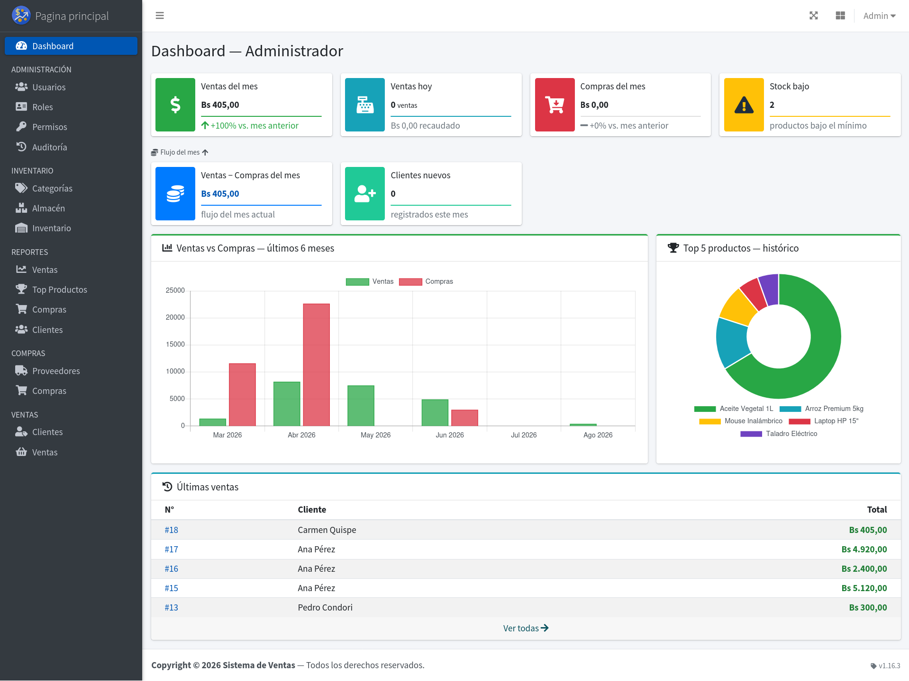
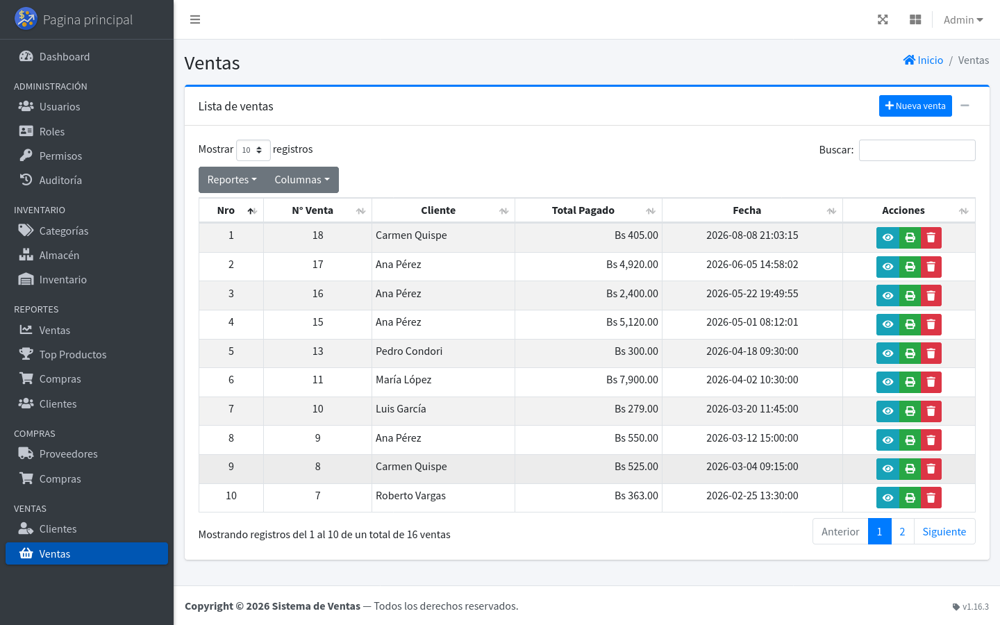
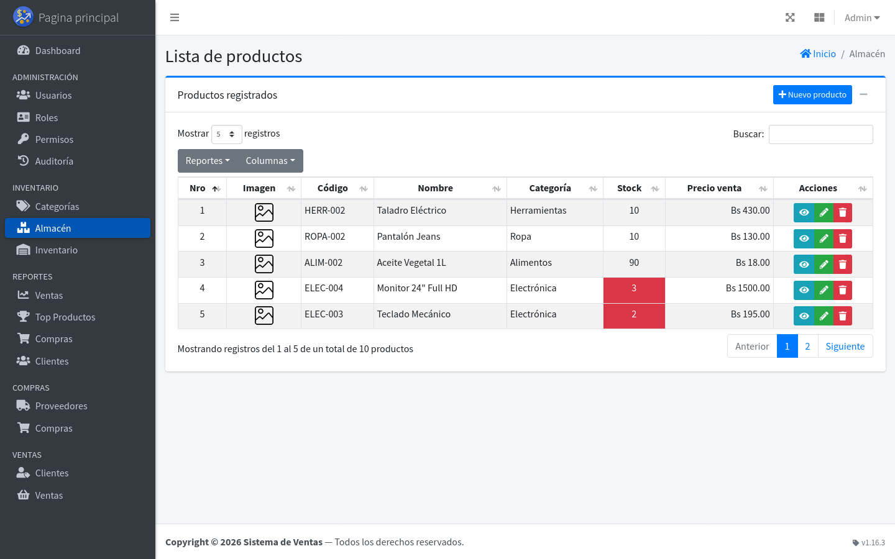
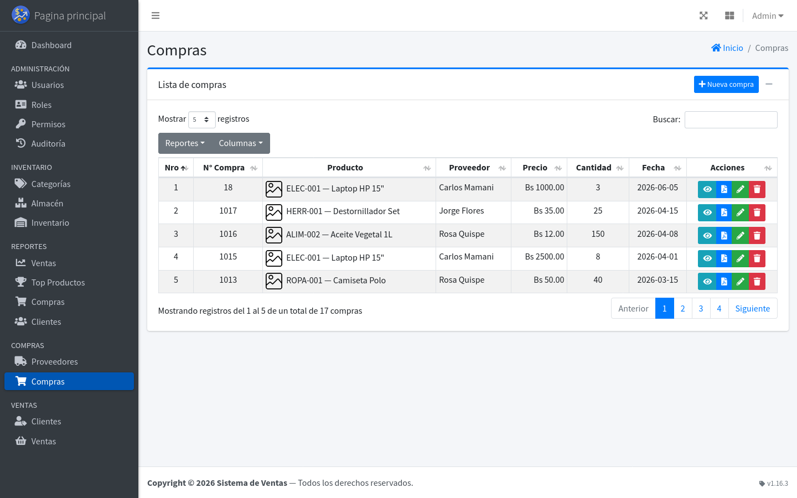

<div align="center">

# Sistema de Ventas — PHP & MySQL

Sistema web de gestión de ventas para pequeñas y medianas empresas. Cubre compras a proveedores, control de inventario, punto de venta con comprobantes PDF internos y reportes por período.


</div>

---

### Dashboard

Panel principal con KPIs del mes, flujo de ventas vs. compras, top productos y últimas ventas.



---

### Ventas

Listado de ventas registradas, con acceso rápido al detalle, impresión de comprobantes internos PDF y eliminación.



---

### Almacén

Catálogo de productos con stock, categoría y precio de venta; alertas visuales cuando el stock está bajo el mínimo.



---

### Compras

Historial de compras a proveedores, con actualización automática de stock al registrar cada una.



## Características

| Módulo          | Descripción                                                                                                       |
| --------------- | ----------------------------------------------------------------------------------------------------------------- |
| **Almacén**     | Gestión de productos con stock, precios, imágenes y categorías                                                    |
| **Ventas**      | POS (Cliente → Carrito → Cobro), venta sin cliente, pagos mixtos y comprobante PDF interno; alerta si la venta deja stock negativo |
| **Compras**     | Registro de compras a proveedores con actualización automática de stock                                           |
| **Inventario**  | Unidades de medida, stock inicial, ingresos, salidas, saldo actual, alertas y descarga CSV de movimientos         |
| **Documentos**  | Cotizaciones y órdenes de compra internas multiítem, con estados, impresión e historial de correcciones           |
| **Reportes**    | Ventas, compras, top productos y clientes por período; export PDF / CSV / Excel                                   |
| **Auditoría**   | Registro de operaciones sensibles (creación, edición, eliminación, login, exportaciones y más) con KPIs y filtros |
| **Clientes**    | Base de datos de clientes con historial de compras                                                                |
| **Proveedores** | Gestión de proveedores y datos de contacto                                                                        |
| **Usuarios**    | Administración de cuentas con roles y permisos granulares                                                         |
| **Permisos**    | Catálogo de permisos y asignación por rol (RBAC) desde la UI, sin editar el seeder                                |
| **Perfil**      | Edición de datos y cambio de contraseña para cualquier rol                                                        |

> Las cantidades se registran como números enteros en esta entrega. La categoría «Crédito» del POS es solo informativa:
> no crea cuentas por cobrar y requiere cobrar el total. Las opciones «Boleta» y «Factura» son registros internos, no DTE.

---

## Stack Tecnológico

| Capa              | Tecnología                                                                     |
| ----------------- | ------------------------------------------------------------------------------ |
| **Backend**       | PHP 8.2+ — MVC custom con PSR-4 vía Composer (sin framework)                   |
| **Base de datos** | MySQL 5.7+ / MariaDB 10.4+ con PDO y prepared statements                       |
| **Frontend**      | AdminLTE 3.2.0, Bootstrap 4, jQuery, DataTables, SweetAlert2                   |
| **PDF**           | TCPDF (`tecnickcom/tcpdf`) — comprobantes internos y reportes                   |
| **Email**         | PHPMailer (`phpmailer/phpmailer`) — SMTP Gmail con App Password                |
| **Testing**       | PHPUnit 11.x — suites Unit e Integration (SQLite in-memory); CI GitHub Actions |

---

## Requisitos

- PHP 8.2 o superior con extensiones `pdo_mysql`, `gd`, `mbstring`, `fileinfo`, `json`
- MySQL 5.7+ / MariaDB 10.4+
- Apache 2.4+ (incluido en XAMPP)
- Composer

---

## Instalación

### 1. Clonar el repositorio

```bash
# Linux
git clone <url> /opt/lampp/htdocs/Sistema_de_Ventas_PHP

# Windows
git clone <url> C:\xampp\htdocs\Sistema_de_Ventas_PHP

# macOS
git clone <url> /Applications/XAMPP/htdocs/Sistema_de_Ventas_PHP
```

### 2. Instalar dependencias

```bash
composer install
```

### 3. Crear e importar la base de datos

**Linux / macOS:**

```bash
mysql -u root -p -e "CREATE DATABASE sistemadeventas;"
mysql -u root -p sistemadeventas < database/schema.sql
mysql -u root -p sistemadeventas < database/seeder.sql
```

**Windows** (desde `C:\xampp\mysql\bin\`):

```bat
mysql -u root -p -e "CREATE DATABASE sistemadeventas;"
mysql -u root -p sistemadeventas < C:\xampp\htdocs\Sistema_de_Ventas_PHP\database\schema.sql
mysql -u root -p sistemadeventas < C:\xampp\htdocs\Sistema_de_Ventas_PHP\database\seeder.sql
```

El seeder crea los siguientes usuarios de prueba:

| Rol           | Email                 | Contraseña   |
| ------------- | --------------------- | ------------ |
| Administrador | admin@sistema.com     | admin123     |
| Vendedor      | vendedor@sistema.com  | vendedor123  |
| Comprador     | comprador@sistema.com | comprador123 |

> Solo para desarrollo. Para producción usa `database/seeder_produccion.sql` (sin datos demo ni usuarios) y
> sigue [docs/guides/despliegue.md](docs/guides/despliegue.md).

### 4. Configurar variables de entorno

```bash
cp .env.example .env
```

Variables mínimas:

```dotenv
DB_HOST=localhost
DB_NAME=sistemadeventas
DB_USER=root
DB_PASS=
APP_URL=http://localhost/Sistema_de_Ventas_PHP/public
APP_TIMEZONE=America/Santiago   # también se aplica como zona horaria de la sesión de MySQL
APP_CURRENCY_SYMBOL=CLP
APP_DEBUG=false
SESSION_LIFETIME=60
REMEMBER_LIFETIME=14
```

Para habilitar el restablecimiento de contraseña por email:

```dotenv
MAIL_HOST=smtp.gmail.com
MAIL_PORT=587
MAIL_USERNAME=tu_email@gmail.com
MAIL_PASSWORD=xxxx_xxxx_xxxx_xxxx
MAIL_ENCRYPTION=tls
MAIL_FROM_ADDRESS=tu_email@gmail.com
MAIL_FROM_NAME="Sistema de Ventas"
```

> `APP_URL` debe incluir `/public`. `MAIL_PASSWORD` debe ser una **Contraseña de Aplicación** de Google, no la contraseña de la cuenta.
> La selección de moneda configura solo la presentación: los documentos de venta de esta versión son registros internos,
> no boletas/facturas tributarias ni DTE enviados o validados por el SII.

### 5. Permisos de directorio (Linux / macOS)

```bash
chmod 755 public/uploads/products/
```

### 6. Iniciar el servidor

**Linux:** `sudo /opt/lampp/lampp start`

**Windows:** Abrir `xampp-control.exe` e iniciar Apache y MySQL.

**macOS:** `sudo /Applications/XAMPP/xamppfiles/xampp start`

Acceder en: `http://localhost/Sistema_de_Ventas_PHP/public/`

### 7. Uso en una red local (dos personas)

1. Deja XAMPP y la base de datos instalados en el PC que actuará como servidor. Reserva una dirección IP local
   estable para ese equipo (por ejemplo, `192.168.1.20`) en el router.
2. En `.env` del servidor configura `APP_URL=http://192.168.1.20/Sistema_de_Ventas_PHP/public`. Ambos equipos
   deben estar en la misma red local y abrir esa dirección desde el navegador.
3. En el Firewall de Windows permite Apache (puerto 80) solo en redes privadas. No abras el puerto de MySQL
   (3306) a la red: la aplicación y la base de datos funcionan en el PC servidor; los otros equipos acceden
   únicamente por el navegador.
4. Crea una cuenta distinta para cada persona. No compartan el mismo usuario: así cada movimiento queda asociado
   a quien lo registró.
5. El sistema permite registrar ventas que superen el stock, pero avisa y deja el saldo negativo para facilitar
   el registro de diferencias; revisa Inventario y corrige con un ajuste trazable.

**Respaldo en el disco USB:** crea en el disco una carpeta, por ejemplo `F:\Respaldos\Ventas`. Cada día,
con Apache y MySQL activos, ejecuta desde PowerShell (se solicitará la contraseña del usuario de BD):

```powershell
$fecha = Get-Date -Format 'yyyyMMdd-HHmm'
& 'C:\xampp\mysql\bin\mysqldump.exe' --single-transaction -u respaldo -p sistemadeventas `
  --result-file="F:\Respaldos\Ventas\sistemadeventas-$fecha.sql"
Compress-Archive -Path 'C:\xampp\htdocs\Sistema_de_Ventas_PHP\public\uploads\products\*' `
  -DestinationPath "F:\Respaldos\Ventas\productos-$fecha.zip" -Force
```

Usa un usuario de MySQL con permiso de lectura sobre la base y guarda los archivos fuera del PC servidor.
Configura estas órdenes en el Programador de tareas si necesitas una copia automática. Comprueba periódicamente
que los archivos se abren y prueba una restauración en una base separada antes de depender de la copia.
Para restaurar, detén la aplicación, crea una base vacía y ejecuta desde `cmd.exe`:
`C:\xampp\mysql\bin\mysql.exe -u usuario -p sistemadeventas < F:\Respaldos\Ventas\sistemadeventas-fecha.sql`.
Restaura también el archivo ZIP correspondiente en `public\uploads\products`.

---

## Actualización

Si ya tienes una versión anterior del sistema instalada, aplica las migraciones
pendientes sobre tu base de datos existente, en orden. Los archivos 003, 005,
006, 007, 008 y 009 son repetibles sin efectos; 001, 002, 004 y 010 se ejecutan
**una sola vez** (re-ejecutar una no-repetible daría error de duplicado o de
columna inexistente). Las migraciones 016 y 017 también se ejecutan una sola vez.

**Linux / macOS:**

```bash
mysql -u root -p sistemadeventas < database/migrations/001_permisos.sql
mysql -u root -p sistemadeventas < database/migrations/002_ventas_id_usuario.sql
mysql -u root -p sistemadeventas < database/migrations/003_permisos_version.sql
mysql -u root -p sistemadeventas < database/migrations/004_view_purchases_all.sql
mysql -u root -p sistemadeventas < database/migrations/005_reports_admin_only.sql
mysql -u root -p sistemadeventas < database/migrations/006_carrito_precio_unitario.sql
mysql -u root -p sistemadeventas < database/migrations/007_devoluciones.sql
mysql -u root -p sistemadeventas < database/migrations/008_formas_de_pago.sql
mysql -u root -p sistemadeventas < database/migrations/009_ventas_sin_cliente.sql
mysql -u root -p sistemadeventas < database/migrations/010_quitar_referencia_detalle_pagos.sql
mysql -u root -p sistemadeventas < database/migrations/011_pos_reservas.sql
mysql -u root -p sistemadeventas < database/migrations/012_integridad_unicos.sql
mysql -u root -p sistemadeventas < database/migrations/013_tokens_y_auth.sql
mysql -u root -p sistemadeventas < database/migrations/014_portabilidad_mysql84.sql
mysql -u root -p sistemadeventas < database/migrations/015_decodificar_entidades_html.sql
mysql -u root -p sistemadeventas < database/migrations/016_documentos_comerciales.sql
mysql -u root -p sistemadeventas < database/migrations/017_libro_movimientos_inventario.sql
```

**Windows** (desde `C:\xampp\mysql\bin\`):

```bat
mysql -u root -p sistemadeventas < C:\xampp\htdocs\Sistema_de_Ventas_PHP\database\migrations\001_permisos.sql
mysql -u root -p sistemadeventas < C:\xampp\htdocs\Sistema_de_Ventas_PHP\database\migrations\002_ventas_id_usuario.sql
mysql -u root -p sistemadeventas < C:\xampp\htdocs\Sistema_de_Ventas_PHP\database\migrations\003_permisos_version.sql
mysql -u root -p sistemadeventas < C:\xampp\htdocs\Sistema_de_Ventas_PHP\database\migrations\004_view_purchases_all.sql
mysql -u root -p sistemadeventas < C:\xampp\htdocs\Sistema_de_Ventas_PHP\database\migrations\005_reports_admin_only.sql
mysql -u root -p sistemadeventas < C:\xampp\htdocs\Sistema_de_Ventas_PHP\database\migrations\006_carrito_precio_unitario.sql
mysql -u root -p sistemadeventas < C:\xampp\htdocs\Sistema_de_Ventas_PHP\database\migrations\007_devoluciones.sql
mysql -u root -p sistemadeventas < C:\xampp\htdocs\Sistema_de_Ventas_PHP\database\migrations\008_formas_de_pago.sql
mysql -u root -p sistemadeventas < C:\xampp\htdocs\Sistema_de_Ventas_PHP\database\migrations\009_ventas_sin_cliente.sql
mysql -u root -p sistemadeventas < C:\xampp\htdocs\Sistema_de_Ventas_PHP\database\migrations\010_quitar_referencia_detalle_pagos.sql
mysql -u root -p sistemadeventas < C:\xampp\htdocs\Sistema_de_Ventas_PHP\database\migrations\011_pos_reservas.sql
mysql -u root -p sistemadeventas < C:\xampp\htdocs\Sistema_de_Ventas_PHP\database\migrations\012_integridad_unicos.sql
mysql -u root -p sistemadeventas < C:\xampp\htdocs\Sistema_de_Ventas_PHP\database\migrations\013_tokens_y_auth.sql
mysql -u root -p sistemadeventas < C:\xampp\htdocs\Sistema_de_Ventas_PHP\database\migrations\014_portabilidad_mysql84.sql
mysql -u root -p sistemadeventas < C:\xampp\htdocs\Sistema_de_Ventas_PHP\database\migrations\015_decodificar_entidades_html.sql
mysql -u root -p sistemadeventas < C:\xampp\htdocs\Sistema_de_Ventas_PHP\database\migrations\016_documentos_comerciales.sql
mysql -u root -p sistemadeventas < C:\xampp\htdocs\Sistema_de_Ventas_PHP\database\migrations\017_libro_movimientos_inventario.sql
```

> Ejecuta la migración `016_documentos_comerciales.sql` una sola vez para añadir unidades de medida y documentos
> comerciales. No se ejecuta en instalaciones creadas desde cero con el esquema actualizado.
> Ejecuta también `017_libro_movimientos_inventario.sql` una sola vez para crear el libro inmutable y respaldar las
> correcciones futuras de compras, ventas, devoluciones y ajustes. La migración importa los movimientos existentes
> y estima el saldo de apertura que falta para cuadrar el stock actual; no reconstruye cambios antiguos que no se
> hubieran auditado.
> Si instalaste desde cero con la versión actual, la BD ya incluye todos los
> cambios y no necesitas ejecutar estas migraciones.
>
> La `015` (decodifica las entidades HTML que guardaban versiones anteriores) se ejecuta
> **una sola vez** y solo en bases que vienen de 1.19.0 o anteriores; a diferencia de las
> demás no es reejecutable.

---

## Control de Acceso

El sistema usa RBAC granular: cada ruta declara el permiso que requiere y el acceso se evalúa en tiempo de ejecución, sin comparaciones de nombre de rol hardcodeadas. Los permisos se administran desde la UI (`/permissions` para el catálogo, `/roles/permisos/{id}` para asignarlos a un rol) — los cambios se aplican a los usuarios activos de ese rol en su siguiente request, sin necesidad de re-login.

| Rol             | Acceso                                                                                |
| --------------- | ------------------------------------------------------------------------------------- |
| `Administrador` | Acceso completo a todos los módulos, incluidos reportes y auditoría                   |
| `Vendedor`      | Ventas, clientes y productos (lectura) — **solo sus propias ventas**                  |
| `Comprador`     | Compras, proveedores, productos (lectura) y categorías — **solo sus propias compras** |

**Scoping por usuario (`*_all`):** además de los permisos por módulo, `view_sales_all` y `view_purchases_all`
distinguen "ver todos los registros" de "ver solo los propios". Sin ellos, dashboard, listados y detalle
(`show`/`edit`/`destroy`) de ventas/compras se filtran automáticamente por `id_usuario` — un usuario no puede ver ni
modificar registros ajenos ni siquiera por URL directa. Solo Administrador los tiene por defecto; un rol nuevo sin
esos permisos queda scopeado a sus propios registros sin tocar código.

---

## Seguridad

- **SQL Injection** — 100% PDO con prepared statements; enteros interpolados con cast `(int)` explícito
- **CSRF** — token obligatorio en todos los formularios POST y endpoints AJAX
- **XSS** — `htmlspecialchars()` en todos los outputs HTML
- **Contraseñas** — `password_hash()` / `password_verify()`; mínimo 8 caracteres en creación, cambio y restablecimiento
- **Acceso a registros ajenos** — ventas y compras se filtran por `id_usuario` salvo permiso `*_all`; bloqueado
  también en `show`/`edit`/`update`/`destroy` para prevenir acceso por URL directa (IDOR), no solo en el listado
- **Escalada de privilegios** — gestionar usuarios o asignar permisos no habilita a otorgarse `is_superadmin`: solo
  un superusuario puede hacerlo, y también para editar o eliminar a un usuario/rol superusuario
- **Sesiones revalidadas en cada petición** — si la cuenta fue eliminada o su rol cambió, `Auth::check()` cierra la
  sesión o recarga los permisos desde BD, sin esperar al siguiente login
- **Sobreventa** — se permite registrar una venta superior al stock, con advertencia al agregar y confirmar; el saldo negativo queda visible para su corrección trazable
- **Totales** — calculados server-side desde la BD dentro de la transacción; el valor del POST se ignora
- **Rate limiting** — 5 intentos fallidos bloquean la cuenta 15 minutos
- **"Recordarme"** — cookie httponly/samesite=Strict con token SHA-256 rotado en cada auto-login
- **Timeout de sesión** — expiración por inactividad configurable (default: 60 minutos)
- **Restablecimiento de contraseña** — token `bin2hex(random_bytes(32))`, expiración 1 hora, un solo uso

---

## Testing

```bash
composer test             # todas las suites
composer test:unit        # Unit — lógica pura, sin BD (rápido, ideal pre-commit)
composer test:integration # Integration — SQLite in-memory
composer test:coverage    # con reporte de cobertura (requiere PCOV)
```

CI con GitHub Actions en PHP 8.2 y 8.3. Ver [docs/guides/testing.md](docs/guides/testing.md) para convenciones de testing.

---

## Documentación para Desarrolladores

| Archivo                                                                                                                                                              | Propósito                                                        |
| -------------------------------------------------------------------------------------------------------------------------------------------------------------------- | ---------------------------------------------------------------- |
| [AGENTS.md](AGENTS.md)                                                                                                                                               | Arquitectura MVC, stack, convenciones de código, prohibiciones   |
| [docs/constitution.md](docs/constitution.md)                                                                                                                         | Principios no negociables del proyecto (SDD)                     |
| [docs/roadmap.md](docs/roadmap.md)                                                                                                                                   | Hecho / en curso / backlog de features (SDD)                     |
| [docs/guides/desarrollo.md](docs/guides/desarrollo.md)                                                                                                               | Puesta en marcha local: XAMPP, BD, `.env`, permisos de archivos  |
| [docs/guides/arquitectura.md](docs/guides/arquitectura.md) · [docs/schema.md](docs/schema.md)                                                                        | Árbol de archivos, enrutamiento y esquema de BD                  |
| [docs/guides/autenticacion.md](docs/guides/autenticacion.md) · [docs/guides/frontend.md](docs/guides/frontend.md) · [docs/guides/testing.md](docs/guides/testing.md) | Detalle de permisos y sesión, frontend y testing                 |
| [docs/app-flow.md](docs/app-flow.md) · [docs/ux-brief.md](docs/ux-brief.md)                                                                                          | Recorridos de usuario y criterios de UX (derivados de las specs) |
| [CLAUDE.md](CLAUDE.md)                                                                                                                                               | Instrucciones de Claude Code (skills y flujo SDD)                |
| [PROMPTS.md](PROMPTS.md)                                                                                                                                             | Plantillas de prompts para agentes IA                            |
| [CONTRIBUTING.md](CONTRIBUTING.md)                                                                                                                                   | Flujo de contribución: PRs, commits, testing                     |
| [docs/guides/despliegue.md](docs/guides/despliegue.md)                                                                                                               | Guía de despliegue en producción (hosting, Nginx, `.env`, BD)    |
| [CHANGELOG.md](CHANGELOG.md)                                                                                                                                         | Historial de versiones                                           |

> Lee [AGENTS.md](AGENTS.md) antes de contribuir — es la fuente de verdad del proyecto.

---

## Contribuciones

Lee [CONTRIBUTING.md](CONTRIBUTING.md) para el flujo completo. En resumen: abre un issue → fork → rama → código siguiendo [AGENTS.md](AGENTS.md) → PR con descripción clara.

---

<div align="center">

Distribuido bajo la **[Licencia MIT](LICENSE)**.

</div>
